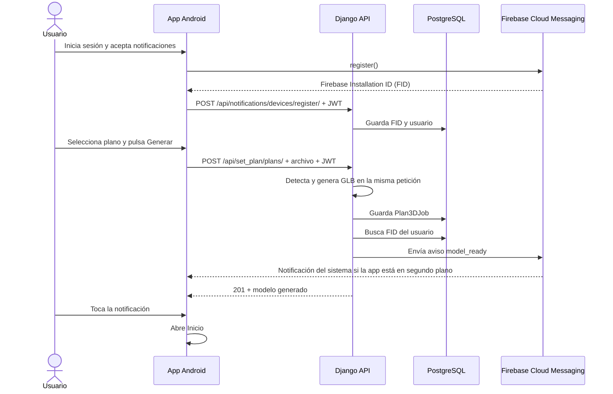
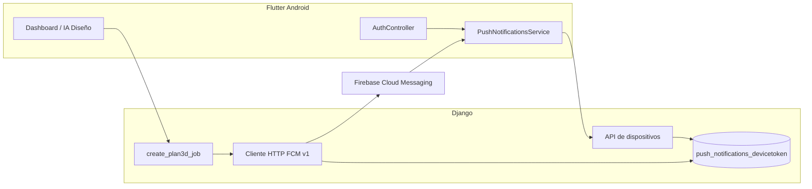

# Informe de cambios: notificaciones push al generar modelos 3D

**Proyecto:** Plasma3D  
**Rama:** `notificaciones-push`  
**Fecha de revisión:** 19 de noviembre de 2026  
**Alcance comprobado:** código de la rama, backend local en Docker, base de datos local y app Android conectada. No se desplegó la rama en producción ni se hizo commit de estos cambios.

## 1. Resumen

Se añadió Firebase Cloud Messaging (FCM) a la app Android y un módulo nuevo en Django para vincular un dispositivo con un usuario y enviarle un aviso cuando `POST /api/set_plan/plans/` termina de generar un GLB. La generación **sigue siendo síncrona**: el servidor procesa el plano dentro de la petición HTTP y envía la push justo antes de devolver `201 Created`.

También se protegió ese endpoint con JWT y una comprobación de pertenencia, se corrigió un error de GetX que apareció al abrir la app, y se guardó la clave privada de Firebase fuera de Git y del contexto de construcción de Docker.

**Resultado observado:** el backend local tiene la migración aplicada y un dispositivo Android registrado. Enviamos una push de prueba para un modelo existente (#3): FCM aceptó un envío y Android registró una notificación activa. El usuario también informó que el flujo le funciona. Esa prueba técnica de transporte, por sí sola, no demuestra recuperación de trabajos si el proceso del backend se interrumpe.

## 2. Mapa del flujo actual

### Mapa visible en el editor de texto

```text
                         REGISTRO DEL TELÉFONO
  ┌─────────────────┐     FID       ┌─────────────────────┐
  │ Flutter Android │ ◄──────────── │ Firebase / FCM      │
  │                 │               └─────────────────────┘
  │ AuthController  │ ── FID + JWT ──► API de dispositivos
  └─────────────────┘                     │
                                          ▼
                            ┌──────────────────────────────┐
                            │ PostgreSQL                   │
                            │ tabla DeviceToken            │
                            └──────────────────────────────┘

                         GENERACIÓN Y AVISO
  Usuario ── Pulsa Generar ──► App Android
                                  │ POST plano + JWT
                                  ▼
                             Django API
                                  │ detecta plano y crea GLB
                                  ▼
                            Plan3DJob guardado
                                  │ busca FID del usuario
                                  ▼
                             Firebase / FCM
                                  │ push: "modelo listo"
                                  ▼
                       Notificación en el teléfono
                                  │ al tocarla
                                  ▼
                          Inicio de Plasma3D
```

**Punto de espera:** Django detecta y genera dentro de la petición de subida. La push sale después de guardar el GLB y antes de la respuesta HTTP `201`.

### Mapa de archivos y responsabilidades

```text
plasma_mobile/
  lib/main.dart ──────────────── Inicializa Firebase en Android
  lib/notifications/──────────── Permiso, registro FCM, recepción y apertura
  lib/screens/auth/───────────── Envía / desvincula FID con la sesión JWT
  lib/api/auth_service.dart ──── POST a los endpoints de dispositivos
  android/app/────────────────── google-services.json + metadatos Android
                      │
                      │ HTTP con JWT
                      ▼
plasma3d_api/
  push_notifications/views.py ─ API autenticada de dispositivos
  push_notifications/models.py  FID asociado al ID de usuario
  push_notifications/clients.py OAuth + llamada REST a FCM
  plans/views.py ─────────────── Genera GLB y dispara aviso de éxito
                      │
                      ▼
                PostgreSQL + Firebase Cloud Messaging
```

### Versión Mermaid para la vista previa



La app muestra un snackbar para mensajes recibidos en primer plano. Cuando el usuario toca una notificación del sistema, abre **Inicio**; todavía no abre directamente el detalle del modelo indicado por `model_id`.



## 3. Inventario completo de archivos

### Backend: nuevos

| Archivo | Función |
|---|---|
| [`push_notifications/__init__.py`](../plasma3d_api/push_notifications/__init__.py) | Declara el paquete Python. |
| [`push_notifications/apps.py`](../plasma3d_api/push_notifications/apps.py) | Configura la nueva app Django. |
| [`push_notifications/models.py`](../plasma3d_api/push_notifications/models.py) | Define `DeviceToken`: propietario, FID, plataforma y fechas. |
| [`push_notifications/serializers.py`](../plasma3d_api/push_notifications/serializers.py) | Valida identificador y plataforma de las peticiones. |
| [`push_notifications/views.py`](../plasma3d_api/push_notifications/views.py) | Registra y desvincula dispositivos autenticados. |
| [`push_notifications/urls.py`](../plasma3d_api/push_notifications/urls.py) | Expone las dos rutas de dispositivos. |
| [`push_notifications/clients.py`](../plasma3d_api/push_notifications/clients.py) | Obtiene una credencial OAuth de la cuenta de servicio y envía mensajes por la API HTTP v1 de FCM. Usa `requests` y `google-auth`, que ya estaban en el backend. |
| [`push_notifications/migrations/__init__.py`](../plasma3d_api/push_notifications/migrations/__init__.py) | Declara el paquete de migraciones. |
| [`push_notifications/migrations/0001_initial.py`](../plasma3d_api/push_notifications/migrations/0001_initial.py) | Crea la tabla de dispositivos. |

### Backend y configuración general: modificados

| Archivo | Cambio |
|---|---|
| [`plans/views.py`](../plasma3d_api/plans/views.py) | El endpoint de subida requiere JWT, comprueba que `usuario` coincide con `request.user.id` y llama al envío de push al terminar el GLB. |
| [`plasma3d_api/settings.py`](../plasma3d_api/plasma3d_api/settings.py) | Añade `push_notifications` a `INSTALLED_APPS`. |
| [`plasma3d_api/urls.py`](../plasma3d_api/plasma3d_api/urls.py) | Monta `/api/notifications/`. |
| [`.env.sample`](../.env.sample) | Documenta `FIREBASE_PROJECT_ID` y `FIREBASE_SERVICE_ACCOUNT_FILE`. |
| [`.gitignore`](../.gitignore) y [`plasma3d_api/.gitignore`](../plasma3d_api/.gitignore) | Mantienen la clave privada fuera de Git y permiten incluir la migración nueva, aunque el repositorio ignora otras migraciones por defecto. |
| [`plasma3d_api/.dockerignore`](../plasma3d_api/.dockerignore) | Excluye `secrets/` del contexto de construcción para que la clave privada no entre en una imagen Docker. |

### Flutter y Android: nuevos

| Archivo | Función |
|---|---|
| [`lib/notifications/push_notifications_service.dart`](../plasma_mobile/lib/notifications/push_notifications_service.dart) | Pide permiso, registra la instalación en FCM y maneja mensajes en primer plano y pulsaciones sobre notificaciones. |
| [`lib/firebase_options.dart`](../plasma_mobile/lib/firebase_options.dart) | Configuración Android generada por FlutterFire. Contiene identificadores de cliente, no la clave privada del servidor. |
| [`android/app/google-services.json`](../plasma_mobile/android/app/google-services.json) | Configuración cliente de la app Android registrada en Firebase. |
| [`firebase.json`](../plasma_mobile/firebase.json) | Metadatos de configuración generados por FlutterFire CLI. |

### Flutter y plataformas: modificados

| Archivo | Cambio |
|---|---|
| [`pubspec.yaml`](../plasma_mobile/pubspec.yaml) y [`pubspec.lock`](../plasma_mobile/pubspec.lock) | Incorporan `firebase_core` y `firebase_messaging` y fijan las dependencias resueltas. |
| [`lib/main.dart`](../plasma_mobile/lib/main.dart) | Inicializa Firebase solo en Android y activa el servicio de mensajes. |
| [`lib/api/auth_service.dart`](../plasma_mobile/lib/api/auth_service.dart) | Añade llamadas para registrar y desvincular la instalación mediante JWT. |
| [`lib/screens/auth/service/auth_controller.dart`](../plasma_mobile/lib/screens/auth/service/auth_controller.dart) | Sincroniza el FID tras login, al renovarse y en logout; lo conserva localmente en GetStorage. |
| [`lib/screens/splash/splash_screen.dart`](../plasma_mobile/lib/screens/splash/splash_screen.dart) | Vuelve a sincronizar el FID cuando se restaura una sesión. |
| [`android/app/src/main/AndroidManifest.xml`](../plasma_mobile/android/app/src/main/AndroidManifest.xml) | Habilita el registro basado en Firebase Installation ID. |
| [`android/app/build.gradle.kts`](../plasma_mobile/android/app/build.gradle.kts) y [`android/settings.gradle.kts`](../plasma_mobile/android/settings.gradle.kts) | Aplican el complemento Google Services. |
| [`lib/screens/main/sidebar/widget/config_options_card.dart`](../plasma_mobile/lib/screens/main/sidebar/widget/config_options_card.dart) | Sustituye un `Obx` inválido por `GetBuilder<ThemeController>`. Soluciona la excepción de GetX observada al arrancar. |
| [`macos/Flutter/GeneratedPluginRegistrant.swift`](../plasma_mobile/macos/Flutter/GeneratedPluginRegistrant.swift), [`windows/flutter/generated_plugin_registrant.cc`](../plasma_mobile/windows/flutter/generated_plugin_registrant.cc) y [`windows/flutter/generated_plugins.cmake`](../plasma_mobile/windows/flutter/generated_plugins.cmake) | Archivos automáticos que Flutter actualizó al añadir los paquetes. No se configuraron push para esas plataformas. |

**Archivos privados locales:** el `.env` de la raíz recibió las dos variables de Firebase. La clave descargada se movió a `plasma3d_api/secrets/firebase-admin.json`; se comprobó que corresponde al proyecto `plasma3d-96467`. Ambos están ignorados por Git. No se incluyen sus contenidos en este informe.

**Cambios fuera del repositorio:** se creó en Firebase Console el proyecto `Plasma3D` (`plasma3d-96467`) y se registró la app Android con paquete `com.example.plasma_mobile`. Se instalaron Firebase CLI y FlutterFire CLI en el equipo y se inició sesión en la CLI. El usuario generó la clave de cuenta de servicio en la consola; después se trasladó al backend local. Una compilación de depuración se instaló en el teléfono conectado. Si cambia el `applicationId` de Android, habrá que registrar ese nuevo paquete en Firebase y regenerar la configuración cliente.

## 4. Contratos HTTP modificados y nuevos

| Método y ruta | Antes / ahora | Efecto |
|---|---|---|
| `POST /api/set_plan/plans/` | Antes permitía la petición sin permiso explícito en la vista y confiaba en el campo `usuario`. Ahora exige JWT y que ese ID coincida con el usuario autenticado. | Un cliente anónimo recibe `401`; uno que envía otro usuario recibe `403`. La app móvil y el cliente web ya envían `Bearer` para sesiones normales. La respuesta exitosa sigue siendo `201` con el modelo. |
| `POST /api/notifications/devices/register/` | Nuevo. Requiere JWT y JSON con `token` (FID) y `platform`. | Guarda o reasigna el FID al usuario autenticado. |
| `POST /api/notifications/devices/unregister/` | Nuevo. Requiere JWT y el mismo JSON. | Borra el FID del usuario actual y responde `204`. |

El evento push incluye `type=model_ready`, `model_id` y `status=built`. Se dispara **solo** desde la subida directa `POST /api/set_plan/plans/`. No se añadió a los flujos `plans/detect/`, `plans/<id>/build/`, `plans_json/`, creación de modelo vacío ni regeneración.

## 5. Cambios en PostgreSQL

Se creó la tabla **`push_notifications_devicetoken`** con:

| Columna | Propósito |
|---|---|
| `id` | Clave primaria. |
| `user_id` | ID del usuario dueño del dispositivo; tiene índice, pero **no es una clave foránea**. |
| `token` | FID único de la instalación; el nombre del campo quedó como `token`. |
| `platform` | `android` o `ios`. |
| `created_at`, `updated_at` | Fechas de creación y última actualización. |

**No se cambiaron los esquemas** de `Usuario`, `Pago` ni `Plan3DJob`, ni se añadió un estado `processing`. En la base local de desarrollo, `0001_initial` figura aplicada y la tabla existe. En el momento de la auditoría había **un registro de dispositivo**, creado al abrir la app en el teléfono. Este informe no afirma que la migración esté aplicada en la base de producción.

La falta de clave foránea evita acoplar la migración nueva a la app `users`, cuyas migraciones están ignoradas en este repositorio. A cambio, si se elimina un usuario, su fila de dispositivo puede quedar huérfana hasta que se limpie explícitamente.

## 6. Ventajas y límites de la solución

### Ventajas

- El usuario recibe un aviso del sistema en Android cuando la generación termina con éxito y la app está en segundo plano.
- Se pueden asociar varios teléfonos a la misma cuenta: cada FID ocupa una fila y el emisor recorre los dispositivos del usuario.
- El registro y la baja del dispositivo requieren JWT. La subida comprueba pertenencia del usuario.
- La clave privada permanece fuera de Git y, tras la corrección de `.dockerignore`, fuera de la imagen Docker construida desde este equipo.
- El backend no necesitó un paquete Python nuevo: reutiliza `google-auth` y `requests` para FCM HTTP v1.
- La corrección de Configuración elimina una excepción de GetX que afectaba al arranque del menú principal.

### Límites y desventajas

1. **No existe cola de trabajos.** La subida, inferencia y generación ocurren en una sola petición. Si la subida se corta, el servidor cae o se agota el tiempo del worker, no hay reintento automático ni garantía de aviso. Poner la app en segundo plano funcionó en la prueba observada; forzar su cierre durante la subida sigue siendo incierto.
2. **Solo se notifica el éxito.** Un fallo de conversión, detección o generación devuelve error HTTP si la app sigue conectada, pero no envía push de error.
3. **El envío se ejecuta dentro de la petición.** Hay una solicitud OAuth y una llamada FCM por dispositivo; cada llamada FCM tiene un límite de 10 segundos, pero la renovación OAuth no tiene un tiempo explícito en este código. La respuesta `201` puede demorarse. Si FCM falla, el modelo queda creado y la petición aún devuelve éxito.
4. **No hay bandeja ni historial de notificaciones** en la app. Al tocar el aviso se abre Inicio, no el modelo exacto. En primer plano pueden aparecer tanto el snackbar push como el snackbar de éxito de la pantalla.
5. **La limpieza de FID no es completamente fiable.** El controlador móvil captura excepciones, pero no inspecciona `Response.isOk` de `GetConnect`; una respuesta HTTP fallida al registrar o desvincular puede pasar inadvertida. Tampoco se eliminan automáticamente FID caducados u órfanos.
6. **El listener de `onRegistered` puede registrar el FID antes de la decisión de permisos** si ya existe sesión y FCM sincroniza al arrancar. La autorización de notificaciones controla la visualización, pero el registro backend no está condicionado en ese listener por el permiso.
7. **Solo Android está configurado en Firebase.** `firebase_options.dart` se generó para Android y `main.dart` inicializa Firebase solo allí. iOS, web y escritorio no reciben estas push.
8. **Producción requiere configuración adicional.** El `docker-compose.prod.yml` actual pasa variables de `.env`, pero no monta la clave privada en `/app/secrets/firebase-admin.json`. Como `.dockerignore` la excluye de la imagen, las notificaciones de producción no funcionarán hasta que el despliegue incorpore un montaje de secreto y aplique la migración.
9. **La migración es obligatoria antes de servir tráfico.** `send_model_ready()` consulta la tabla de dispositivos fuera de su bloque de captura de errores. Si se despliega el código sin crear esa tabla, la subida puede terminar el GLB y luego devolver `500` al consultar dispositivos. El usuario podría reintentar y crear un duplicado.
10. **Firebase se inicializa al arranque de Android.** Un fallo no controlado en `Firebase.initializeApp()` puede impedir que la app llegue a `runApp()`. La entrega en equipos sin servicios de Google no se comprobó.

## 7. ¿Se perjudicó alguna funcionalidad existente?

| Área | Evaluación |
|---|---|
| Subida móvil | Conserva `ModelsService.uploadPlan()` y el contrato `201`, pero ahora depende de un JWT válido y de que el ID de usuario enviado coincida. Una sesión vencida o un ID desactualizado producirá error. El envío FCM puede añadir espera al final. |
| Subida web | Usa el mismo endpoint. Su cliente Axios ya adjunta `Bearer` y la pantalla envía `user.id`; por inspección del código, el flujo normal autenticado es compatible. No se ejecutó una prueba funcional web después del cambio. Clientes anónimos o externos que usaban el endpoint dejarán de funcionar. |
| Registro, login y logout | Login y restauración intentan registrar el FID sin bloquear la navegación. Logout intenta desvincularlo antes de borrar la sesión. Si el backend no responde, GetConnect puede esperar hasta su timeout configurado de 30 segundos antes de completar logout. |
| Configuración / tema | El `Obx` previo lanzaba una excepción porque `isDarkMode` lee GetStorage y no una variable `.obs`. `GetBuilder` responde a `ThemeController.update()` y permitió que el menú principal arrancara sin esa excepción. |
| Visor, edición web, pagos, otros endpoints | No se modificó su código de negocio. El visor recibe el modelo tras una nueva carga de Inicio; no hay enlace directo al modelo. |
| Otras plataformas Flutter | Sus registradores generados cambiaron al añadir dependencias, aunque solo Android inicializa Firebase. No se compilaron iOS, macOS, Windows, Linux ni web después del cambio. |

**Conclusión de impacto:** no encontramos una regresión confirmada en los flujos móviles probados. El cambio de autenticación del endpoint de subida sí es una incompatibilidad deliberada para consumidores anónimos o que envían un ID distinto. Quedan riesgos de latencia, limpieza de FID y despliegue en producción descritos arriba.

## 8. Comprobaciones realizadas y alcance de la evidencia

- `python manage.py check` dentro del contenedor de desarrollo: sin problemas reportados.
- `python manage.py showmigrations push_notifications`: `0001_initial` aplicada.
- Consulta de la base local: la tabla existe y había un dispositivo registrado.
- `flutter analyze` en toda la app: **sin issues** tras sustituir los métodos FCM obsoletos por la API de FID.
- Compilación e instalación de la app de depuración en un Android 15 conectado: completadas. Se observó y corrigió la excepción de GetX; se volvió a compilar e instalar.
- Permiso `POST_NOTIFICATIONS` en el teléfono: concedido.
- Envío de prueba al FID registrado para un **modelo existente #3**: FCM aceptó **1** envío y Android mostró **1** notificación activa de Plasma3D. Esto verificó transporte y visualización en el sistema, no una generación nueva automatizada por esa prueba.
- `git diff --check`: sin problemas de espacios en el diff rastreado.

No se añadieron pruebas automatizadas. Tampoco se ejecutaron pruebas de fallo de FCM, de pérdida de red, de cierre forzado, de concurrencia de varios dispositivos ni de regresión web.

## 9. Recomendaciones en orden de prioridad

1. **Antes de desplegar:** aplicar la migración antes de recibir subidas y montar la clave privada como secreto en el contenedor de producción, manteniéndola fuera de la imagen. Verificar que el archivo del servidor corresponde al proyecto Firebase correcto.
2. **Para garantizar avisos aunque el usuario cierre la app:** mover la generación a una cola persistente (por ejemplo Celery + Redis), devolver un ID de trabajo inmediatamente y guardar estados `pending/processing/built/failed`. Enviar la push desde el worker al completar o fallar.
3. **Para una experiencia más clara:** añadir push de error, abrir el modelo concreto al tocar el aviso y evitar el snackbar duplicado en primer plano.
4. **Para robustez y privacidad:** validar respuestas `isOk`, reintentar registros fallidos, limpiar FID inválidos y borrar filas al eliminar usuarios; condicionar el registro a la decisión de permisos.
5. **Para reducir latencia:** sacar el envío FCM de la petición de generación, incluso si la generación se mantiene síncrona temporalmente.

## 10. Estado de Git

Los cambios de código y configuración siguen **sin commit** en `notificaciones-push`. El `.env` real y el JSON privado de la cuenta de servicio no aparecen en Git. El archivo de configuración Android `google-services.json` y `firebase_options.dart` sí son archivos cliente nuevos pendientes de revisión y commit junto con el resto de la rama.
